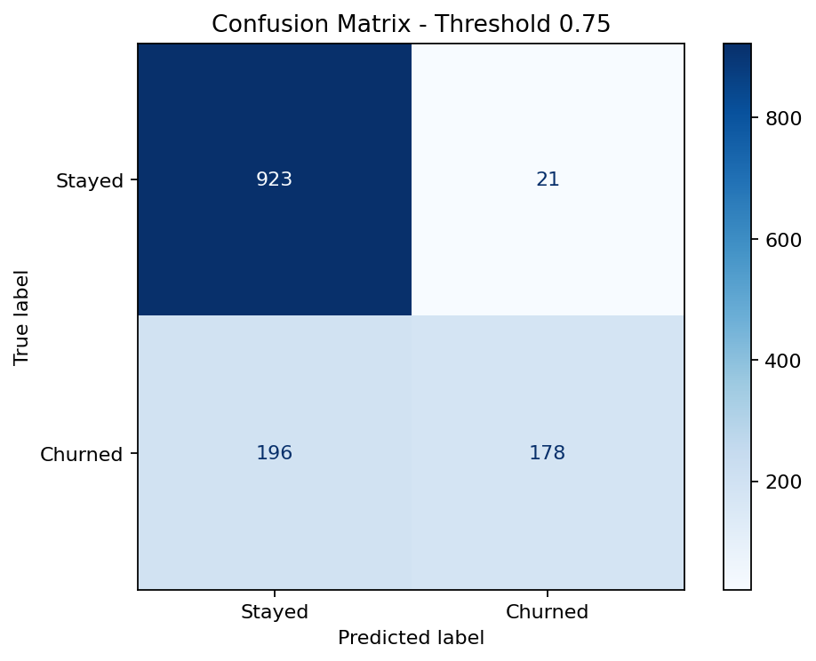
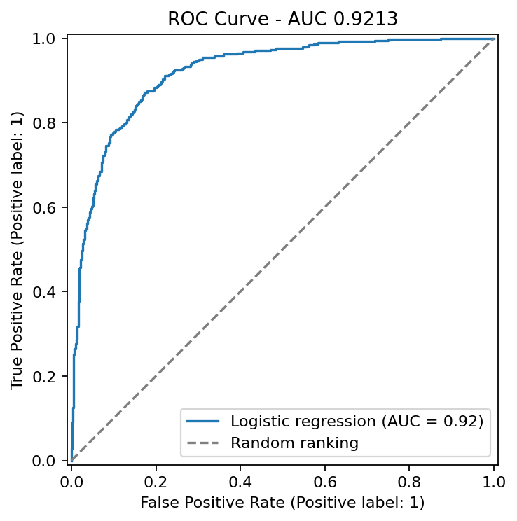
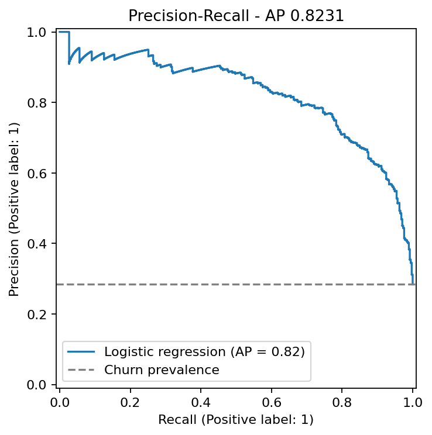
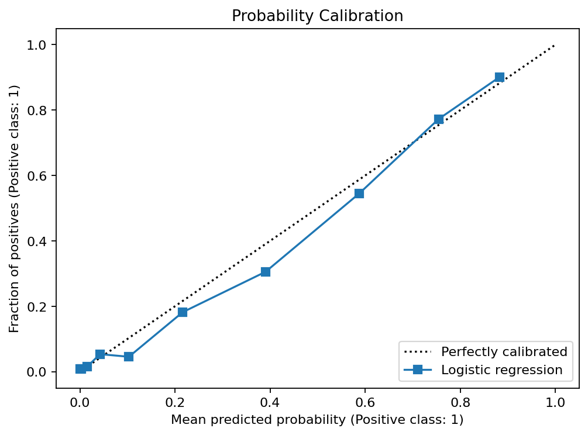

# Customer Churn Using Logistic Regression

A Python machine-learning project that prepares telecom customer data, trains a logistic regression classifier, asks for customer details in the terminal, and produces evaluation reports and charts.

The target is `Customer Status`: **1 = Churned**, **0 = Stayed**. The saved prediction rule uses a **0.75 probability threshold**. A Yes answer means predicted churn, not a guaranteed outcome.

## Dataset

The repository includes the three downloaded CSV files and their generated outputs:

| File | Contents | Role |
|---|---|---|
| `data/telecom_customer_churn.csv` | 7,043 customers, 38 columns | Customer records and outcome |
| `data/telecom_zipcode_population.csv` | 1,671 ZIP codes, 2 columns | Adds population through a ZIP-code merge |
| `data/telecom_data_dictionary.csv` | 40 definitions, 3 columns | Explains columns; not used as training observations |

The merge keeps all 7,043 customers and produces 39 columns. The first binary-classification experiment excludes 454 `Joined` customers because they do not have a Churned/Stayed outcome. The remaining 6,589 customers are split into 5,271 training and 1,318 test records using a stratified 80/20 split and seed 42.

The CSVs are the local downloaded copies used for this experiment, including observed data errors. The original download URL and dataset license have not been recorded in the project; this repository does not assert ownership of the source data.

## Setup

Tested with Python 3.11. Run commands from the repository root.

```bash
python -m venv .venv
```

Activate the environment on Windows PowerShell:

```powershell
.venv\Scripts\Activate.ps1
```

Or on macOS/Linux:

```bash
source .venv/bin/activate
```

Install dependencies:

```bash
python -m pip install -r requirements.txt
```

## Run the Project

```bash
python data_cleaning.py
python model_train.py
python evaluate_model.py
python predict.py
```

`predict.py` asks for customer details interactively, validates answers, looks up population by ZIP code, applies the saved preprocessing, and prints `Will this customer churn? Yes` or `No`. ZIP codes must exist in the bundled population table. Questions for absent phone/internet services are skipped automatically.

Saved models and preprocessing artifacts are included, so prediction and evaluation can also be run without rebuilding. Only load joblib files from trusted sources. Rebuilding generates artifacts for your installed dependency versions.

## Cleaning and Preprocessing

- Checks missing values, duplicate rows/keys, numeric types and ranges, whitespace, ZIP-code format, dictionary alignment, and service contradictions.
- Preserves customer IDs and ZIP codes as text; treats the literal offer `None` as a category rather than missing data.
- Reads the dictionary using its Windows `cp1252` encoding.
- Fills absent-service fields using fixed rules: zero usage/charges and not-applicable options.
- Treats negative referral counts and negative monthly charges as missing. Negative monthly charges are assumed invalid because the dictionary describes service charges and lists refunds separately; this assumption is not an upstream correction.
- Treats invalid binary/offer labels as unknown rather than inventing their meaning.
- Learns medians and modes from training records only. Training medians are 0 referrals and 72.6 monthly charge.
- Converts Yes/No indicators to 1/0 and Gender to Male=1/Female=0. These codes are labels, not rankings. Not-applicable service options map to 0 while service indicators preserve whether the service exists.
- Removes churn category/reason from model inputs, separates the target, and excludes customer ID.
- Excludes City and ZIP code from final encoded inputs to avoid high-cardinality expansion; retains population, latitude, and longitude.
- Standard-scales 15 numeric measurements and one-hot encodes Offer, Internet Type, Contract, and Payment Method, learning from training data only.

The final encoded matrices have **45 numeric features**. Original CSVs are unchanged. The combined intermediate CSV intentionally retains unknown values; median/mode filling is completed in the train/test outputs.

## Model and Prediction Rule

The saved baseline uses `LogisticRegression` with `solver="lbfgs"`, L2 regularization, `C=1`, `max_iter=2000`, and `random_state=42`. It converged in 48 iterations. Convergence warnings stop training before an unconverged model is saved.

`models/customer_churn_model.joblib` expects the prepared numeric feature columns, not a raw customer dictionary. `predict.py` performs the required preparation.

The threshold is stored in `models/training_summary.json`. `predict_churn()` applies it using `predict_proba()`. Calling the estimator's own `predict()` still uses its default decision rule. To change the configured threshold, edit `PREDICTION_THRESHOLD` in `model_train.py`, rerun training, and regenerate evaluation.

## Test Results

The following results use the same 1,318 test customers:

| Metric | Threshold 0.50 | Current threshold 0.75 |
|---|---:|---:|
| Accuracy | 86.27% | 83.54% |
| Churn precision | 74.81% | 89.45% |
| Churn recall | 77.81% | 47.59% |
| Churn F1 | 0.7628 | 0.6213 |

ROC AUC is **0.9213** and average precision is **0.8231**, both calculated from probabilities rather than thresholded answers. Always predicting Stayed gives 71.62% accuracy.

At threshold 0.75:

| Actual / Predicted | Stayed | Churned |
|---|---:|---:|
| Stayed | 923 | 21 |
| Churned | 196 | 178 |

The higher threshold reduces false alarms but misses more churners. It does not improve accuracy in this experiment.









## Evaluation Outputs

`results/evaluation/` includes a readable `results_report.txt`, structured `evaluation.json`, metrics, threshold comparisons, confusion counts, per-customer predictions, model coefficients, and the four charts above. Reported metrics also include specificity, negative predictive value, error rates, balanced accuracy, MCC, Cohen's kappa, log loss, Brier score, and trapezoidal PR AUC. Average precision and trapezoidal PR AUC are distinct summaries.

## Training-Only Experiments

```bash
python tune_model.py
python tune_model.py --compare-penalties
python correlation_selection.py
```

These use five-fold stratified cross-validation with filling/scaling/encoding fitted inside each fold. Correlation selection also occurs inside each fold.

- C tuning: C=100 scored 85.35% average validation accuracy versus 85.24% for C=1, a small 0.114-percentage-point difference.
- L1/L2 comparison with the same `liblinear` solver: L1 at C=1 scored 85.33%, versus 85.28% for L2 at C=1. The difference is small relative to fold variation.
- Correlation cutoffs: retaining all 45 features performed best among tested cutoffs. Removing weak individual correlations did not improve accuracy.

These experiments do not overwrite the saved baseline model. Validation scores are not directly interchangeable with test scores. Experiment results are saved in `results/`.

## Files

```text
data_cleaning.py          Data audit, merge, split, filling, encoding, scaling
model_train.py            Baseline training and threshold prediction helper
predict.py                Interactive customer prediction
evaluate_model.py         Metrics, reports, charts, and prediction exports
tune_model.py             C and penalty comparisons
correlation_selection.py  Correlation ranking and selection experiment
requirements.txt          Tested dependency versions
data/                     Source CSVs and generated cleaned artifacts
models/                   Trained model and training summary
results/                  Evaluation and experiment outputs
```

The upload includes existing generated files, including Python bytecode caches. Those caches are not required to run the project. Some generated reports contain historical local absolute paths; scripts resolve their own project directory and regenerated reports use the current location.

## Limitations

This is an educational classification experiment on recorded outcomes. The dictionary describes quarter-end measurements, but the data lacks dated feature snapshots and individual churn dates. Availability of every input before churn cannot be verified, so these scores do not establish reliable future-churn forecasting.

The test set has already been inspected during development. Later test comparisons should not be described as untouched final validation. A deployment study would need a defined prediction horizon, chronological data, and fresh evaluation records.

Imputed values are estimates, not recovered original values. The current threshold was chosen by the user, not optimized on validation data. There is no deployment, causal claim, or guarantee that retention interventions will work.
